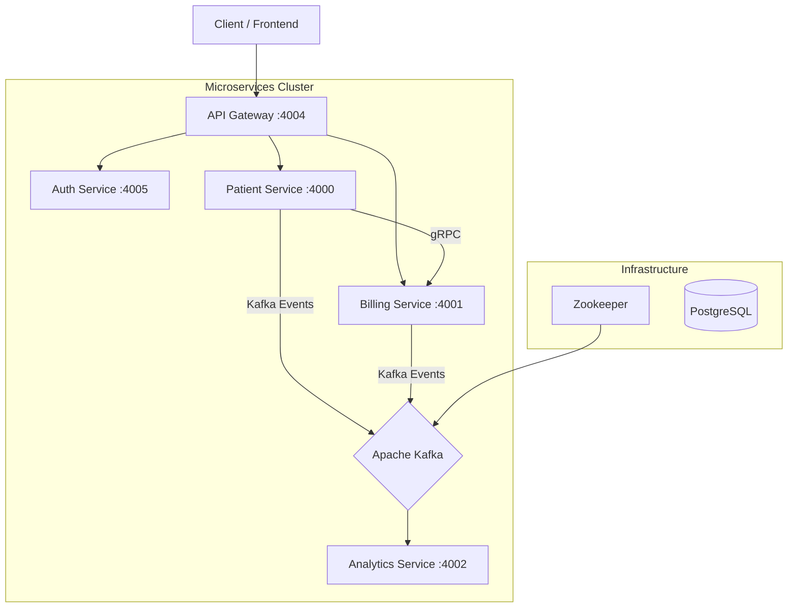

# Java Spring Microservices Project


## 📋 Overview

This project is a robust **Microservices Architecture** implementation using **Java** and **Spring Boot**. It demonstrates a modern, scalable system design incorporating **Event-Driven Architecture** with **Apache Kafka**, high-performance inter-service communication using **gRPC**, and a centralized **API Gateway**.

Designed for scalability and maintainability, the system handles patient management, billing, authentication, and analytics through decoupled, independent services.

## 🏗️ Architecture

The system consists of the following core components:



## 🚀 Tech Stack

- **Core Framework:** Spring Boot 3.4.0, Spring Cloud 2024.0.0
- **Language:** Java 21
- **Communication:**
  - **Synchronous:** gRPC (Protobuf) for high-performance service-to-service calls.
  - **Asynchronous:** Apache Kafka for event-driven messaging.
  - **REST:** Spring Web for external APIs.
- **Gateway:** Spring Cloud Gateway
- **Security:** Spring Security + JWT (JSON Web Tokens)
- **Database:** PostgreSQL (Production/Runtime), H2 (Testing)
- **Documentation:** OpenAPI / Swagger UI (`springdoc-openapi`)
- **Containerization:** Docker & Docker Compose

## 📦 Services Breakdown

| Service | Port | Description |
| :--- | :--- | :--- |
| **API Gateway** | `4004` | Central entry point, handles routing and cross-cutting concerns. |
| **Auth Service** | `4005` | Manages user authentication and JWT token generation. |
| **Patient Service** | `4000` | Core domain service for managing patient records. Uses gRPC and Kafka. |
| **Billing Service** | `4001` | Handles billing operations. Consumes gRPC calls from Patient Service. |
| **Analytics Service** | `4002` | Consumes events from Kafka to generate insights and analytics. |

## 🛠️ Getting Started

### Prerequisites
- **Docker** and **Docker Compose** installed on your machine.
- **Java 21** (if running locally without Docker).
- **Maven** (optional, for local builds).

### Running with Docker Compose (Recommended)

You can spin up the entire infrastructure (Services + Databases + Kafka) with a single command:

```bash
docker-compose up --build
```

This will start:
- Zookeeper & Kafka
- All Microservices (Patient, Auth, Billing, Analytics, Gateway)

### Accessing the Application

Once the services are up, you can access them via the API Gateway:

- **Base URL:** `http://localhost:4004`
- **Swagger UI (API Docs):** Check individual service ports (e.g., `http://localhost:4000/swagger-ui.html` for Patient Service).

## 🧪 Key Features Implementation

- **Event-Driven Communication:** The `patient-service` publishes events to Kafka topics which are consumed by the `analytics-service` for real-time data processing.
- **gRPC Integration:** High-performance synchronous communication between `patient-service` and `billing-service` using Protocol Buffers.
- **Centralized Authentication:** The `auth-service` issues JWTs, which can be validated by the Gateway or other services to secure endpoints.
- **Database per Service:** Each service manages its own data persistence, adhering to microservices best practices.

## 📝 License

This project is open-source and available under the MIT License.
